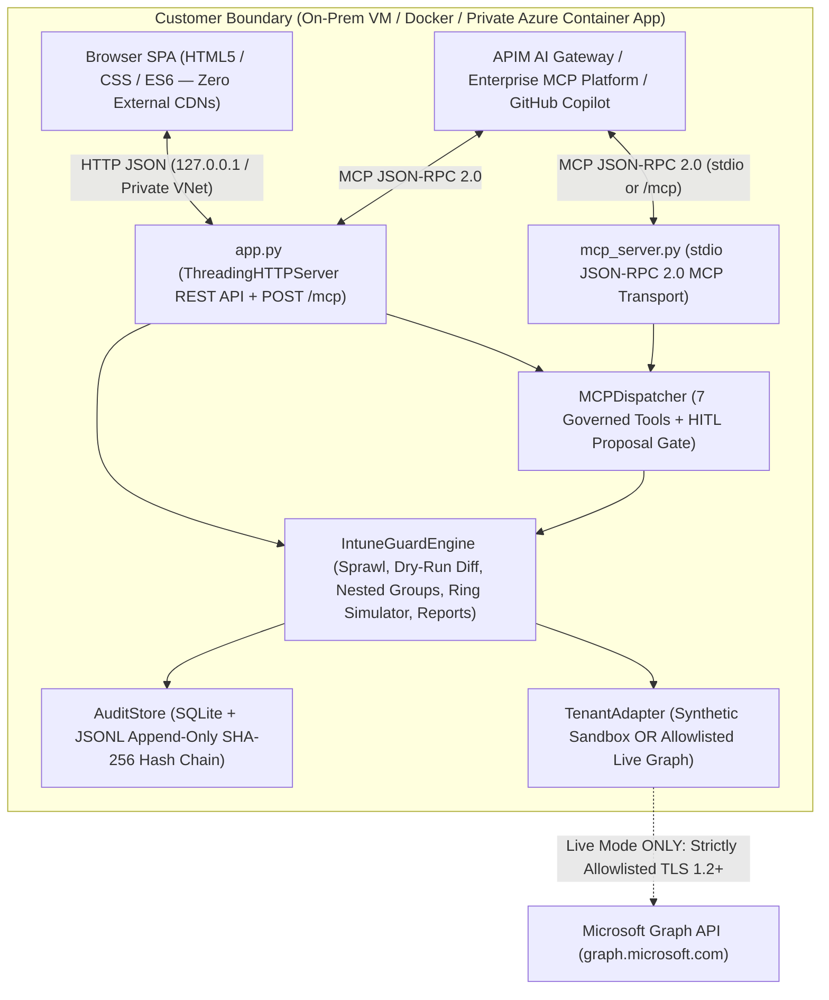

# System Architecture — IntuneGuard Studio

## 1. Architectural Principles

IntuneGuard Studio is purpose-built for **regulated financial institutions and enterprises** that require transparency, local data custody, and strict change control:

1. **Zero Third-Party SaaS Custody:** Runs entirely inside the organization's own network (local workstation, internal Linux/Windows VM, Docker, or private Azure Container App). Tenant metadata and compliance reports never touch an external vendor cloud.
2. **Zero External Runtime Dependencies:** Core backend, HTTP server, SQLite hash-chained audit store, Microsoft Graph adapter, and JSON-RPC 2.0 MCP server run exclusively on the **Python 3.12 standard library**. Zero `node_modules` or sprawling PyPI dependency trees to patch or CVE-triage.
3. **Hard-Enforced Outbound Egress Allowlist:** In `live` mode, `LiveGraphAdapter` enforces a code-level host allowlist (`login.microsoftonline.com` and `graph.microsoft.com` only). Any other destination raises `EgressPolicyViolation`.
4. **Read-Only First, Human-in-the-Loop Writes:** Discovery, sprawl analytics, dry-run diffing, and auditor documentation require **read-only** Graph permissions. All AI/MCP write proposals queue inside the local ITIL CAB Approval Queue and cannot mutate Intune without human RFC review.

---

## 2. Logical Architecture

---

## 3. Data Persistence & Tamper-Evident Audit Flow

Every operational action (tenant snapshot, MCP inspection, MCP write proposal, CAB approval/rejection, ring promotion, or 1-click rollback) writes to two synchronized local artifacts inside `INTUNEGUARD_DATA_DIR`:

1. **`intuneguard_audit.db` (SQLite):** Stores `audit_events`, `rollout_state`, and `pending_proposals`.
2. **`itil_audit_trail.jsonl` (Append-Only JSON Lines):** Ready for ingestion into **Microsoft Sentinel**, Splunk, or syslog forwarders.

Each audit record hashes its canonical payload together with the previous event's `event_hash` (`SHA-256`), enabling instant cryptographic verification via `/api/audit` or the MCP tool `verify_itil_audit_chain`.

---

## 4. Phased Enterprise Integration Roadmap

| Phase | Mode | Graph Permissions | Objective |
| :--- | :--- | :--- | :--- |
| **Phase 0: ARB & CAB Walkthrough** | `synthetic` (0 egress) | None | Interactive live demonstration using 418-policy regulated sandbox. |
| **Phase 1: Live Read-Only Discovery** | `live` (`ALLOW_WRITES=false`) | Read-only Intune/Entra/Audit scopes | Map real 400+ policy sprawl, nested dynamic group traps, and export baseline As-Built docs. |
| **Phase 2: Guided Ring Rollout** | `live` + RFC Gate | Scoped Intune Configuration Write + Managed Identity/Cert | Promote OIB/CIS policies safely across Rings 0→3 with Proactive Remediation self-healing. |
| **Phase 3: Agent 365 & MCP Ops** | `live` + Agent 365 Governance | Read-only MCP + HITL Proposal Queue | Expose IntuneGuard MCP server to Copilot / Security Ops with mandatory CAB approval on writes. |
