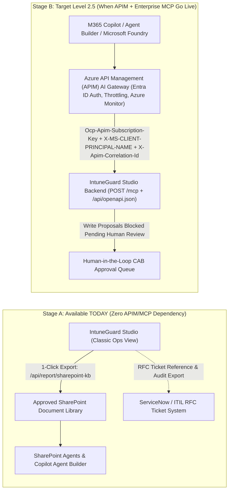

# Enterprise AI Architecture Fit: Level 2.5 APIM-Governed MCP & Day-1 SharePoint Grounding

Many regulated enterprises are building toward an **APIM-Governed Enterprise MCP Architecture** (centralizing authentication, routing, throttling, and auditing through **Azure API Management (APIM) AI Gateway**) while explicitly restricting or disabling certain add-on AI tools (such as Copilot Studio, Security Copilot, or Fabric).

**IntuneGuard Studio** is architected to deliver immediate value using **only conventional automation + Day-1 approved M365 capabilities**, while remaining **plug-and-play ready** for a centralized **Azure APIM AI Gateway + Enterprise MCP Platform** when it reaches production.

---

## 1. Conventional Automation First (AI Is Strictly Optional)

Enterprise AI review boards routinely ask: *"Is AI actually necessary here, or is conventional automation sufficient?"*

- **95% of IntuneGuard Studio is deterministic, conventional engineering:** Guided Learning Tracks, read-only Microsoft Graph snapshot analysis, GPMC GPO XML collision parsing, Assignment Filter blueprints, Proactive Remediation PowerShell scripts, and SHA-256 hash-chained ITIL audit trails.
- **Classic Ops View (Default):** Operates with **zero AI/LLM calls and zero MCP dependency**. Teams can adopt it immediately without waiting for AI platform approvals.

---

## 2. Two-Stage Integration Blueprint (Available Today vs. Target Architecture)

---

## 3. Built-In Alignment With Enterprise AI Governance Checklists

| Governance Requirement | How IntuneGuard Studio Satisfies It |
| :--- | :--- |
| **No assumption of unavailable platforms** | Zero dependency on **Copilot Studio**, **Microsoft Security Copilot**, or **Microsoft Fabric**. |
| **Use approved Day-1 platforms** | Exports a chunk-friendly Markdown Knowledge Base (`GET /api/report/sharepoint-kb`) directly for **SharePoint Agents** and **Copilot Agent Builder**; supports local **GitHub Copilot** development via `mcp_server.py`. |
| **Avoid shadow point-to-point integrations** | Exposes `GET /api/openapi.json` and `POST /mcp` designed specifically to sit **behind Azure APIM AI Gateway** rather than creating unmanaged direct agent endpoints. |
| **Entra ID identity & least privilege** | Supports `X-MS-CLIENT-PRINCIPAL-NAME` / `X-Forwarded-User` propagation from APIM + optional `INTUNEGUARD_APIM_KEY` gateway enforcement (`Ocp-Apim-Subscription-Key` / `X-IntuneGuard-Apim-Key`) + strictly `*.Read.All` Graph App Registration in Phase 1. |
| **Monitoring & Azure Monitor / App Insights** | Enable `INTUNEGUARD_JSON_LOGS=true` for structured JSON telemetry (timestamp, tool, caller UPN, `X-Apim-Correlation-Id`) ready for **Azure Monitor / Application Insights** and **Microsoft Sentinel**. |
| **Safe PoC validation before production** | Built-in **418-policy Synthetic Sandbox** + **Path A Offline Read-Only Snapshot** allows full PoC validation of accuracy, authorization boundaries, and failure handling with zero production risk. |
